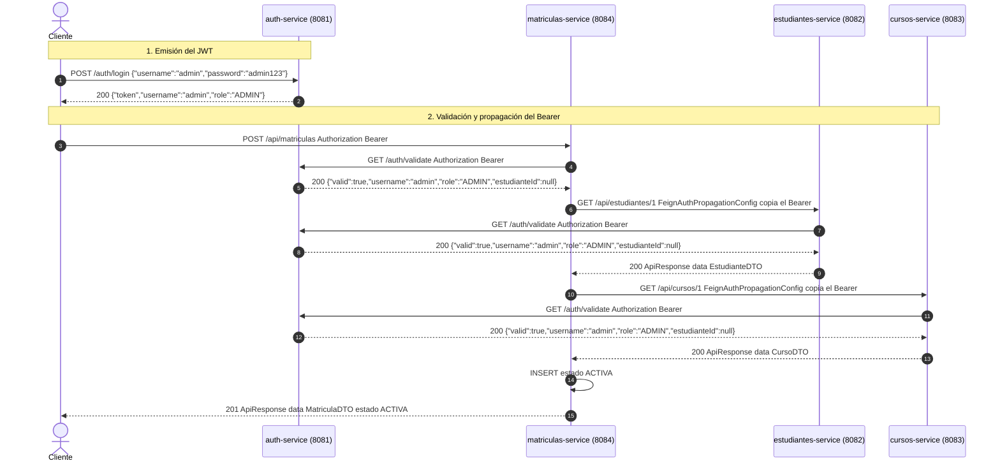

# Memoria técnica. Proyecto S3

Documento de sustentación. Ingeniería de Software III.
Alcance verificado: cinco microservicios Spring Boot 3.2.5, Java 21, Maven 3.9.9 en contenedor, Docker Compose, H2 en memoria.
Evidencia de pruebas: 27 casos, 0 fallos, 0 errores, imagen `maven:3.9.9-eclipse-temurin-21`.

## 1. Resumen ejecutivo y mapa de microservicios

El sistema separa identidad, catálogo, matrícula y calificación en procesos independientes. Cada uno tiene su propia base H2 en memoria, su propio puerto y su propio contrato HTTP. No existe una base compartida ni un módulo Maven agregador. La coherencia entre agregados se obtiene por llamadas síncronas OpenFeign y por referencias lógicas (`Long`), no por claves foráneas JPA.

La imagen de ejecución es `eclipse-temurin:21-jre`. El Dockerfile copia un JAR ya empaquetado (`target/*.jar`) y lo arranca con `java -jar`. Maven no corre dentro de esa imagen. El empaquetado se hizo en un contenedor efímero `maven:3.9.9-eclipse-temurin-21` porque el host no tiene `mvn` en el `PATH` y el JDK por defecto no es el 21. Compose construye las imágenes a partir de esos JAR y las une en la red `proyecto-s3_default`.

| Servicio | Puerto | Base H2 | Responsabilidad | Dependencias de arranque | Variables de Compose |
|---|---:|---|---|---|---|
| auth-service | 8081 | `authdb` | Login BCrypt, JWT HS256, `GET /auth/validate` | Ninguna | Ninguna |
| estudiantes-service | 8082 | `estudiantesdb` | CRUD de estudiantes, correo único, borrado condicionado | auth-service | `AUTH_SERVICE_URL`, `MATRICULAS_SERVICE_URL` |
| cursos-service | 8083 | `cursosdb` | CRUD de cursos, cupo máximo, borrado condicionado | auth-service | `AUTH_SERVICE_URL`, `MATRICULAS_SERVICE_URL` |
| matriculas-service | 8084 | `matriculasdb` | Alta y anulación; cupo y existencia remota | auth, estudiantes, cursos | `AUTH_SERVICE_URL`, `ESTUDIANTES_SERVICE_URL`, `CURSOS_SERVICE_URL` |
| calificaciones-service | 8085 | `calificacionesdb` | Notas por corte y promedio ponderado | auth, matriculas | `AUTH_SERVICE_URL`, `MATRICULAS_SERVICE_URL` |

Dentro de la red, las URLs apuntan al nombre DNS del servicio (`http://auth-service:8081` y equivalentes). Si la variable no existe, `application.yaml` usa `http://localhost:<puerto>`, válido solo para `mvn spring-boot:run` en el host. `localhost` dentro de un contenedor es el propio contenedor.

`depends_on` fija el orden de creación. No espera a que el proceso acepte tráfico: no hay `healthcheck`. Estudiantes y cursos conocen la URL de matrículas y no la declaran en `depends_on`. Ese corte evita un ciclo de arranque. La tolerancia al arranque en frío queda en la aplicación: una llamada prematura falla y se traduce a error remoto.

El secreto HMAC y la expiración (`app.jwt.expiration-ms` = 3 600 000, una hora) viven en el `application.yaml` de auth-service. Compose no los inyecta. Las bases son `jdbc:h2:mem:...;DB_CLOSE_DELAY=-1`. El reinicio del contenedor vacía los datos y la semilla vuelve a cargarse cuando la tabla está vacía.

Roles de semilla: `admin` / `ADMIN`, `docente` / `DOCENTE`, `estudiante` / `ESTUDIANTE` con `estudianteId` 1. Estudiantes siembra 50 correos `estudianteN@demoacademico.edu`. Cursos siembra `IS3-001` (cupo 30), `BD2-001` (cupo 25) y `RED-001` (cupo 2).

## 2. Sustentación de los diez puntos académicos

### 2.1 Seguridad

`POST /api/cursos` con rol `DOCENTE` llega con un Bearer ya aceptado. `AuthValidationFilter` consultó `GET /auth/validate`, cargó la autoridad `DOCENTE` y dejó continuar la cadena. La regla de escritura exige `hasAuthority("ADMIN")`. Spring Security invoca `CustomAccessDeniedHandler`, que responde **403** `AUTH_FORBIDDEN`. El **401** queda reservado a tres casos del filtro: header ausente o sin prefijo `Bearer ` (`AUTH_HEADER_MISSING`), validate que responde 401 (`TOKEN_INVALID`) y cualquier otra falla Feign contra auth-service (`TOKEN_VALIDATION_ERROR`).

Cada petición de negocio delega la firma en auth-service. El secreto permanece en un solo proceso. El costo es una llamada adicional y un punto de disponibilidad: con auth-service detenido, el filtro responde `TOKEN_VALIDATION_ERROR`. Validar HS256 en cada servicio eliminaría esa llamada y obligaría a distribuir `app.jwt.secret`.

El payload del JWT es Base64. Se lee sin el secreto. El token de este sistema lleva `sub`, `role`, `iat`, `exp` y, solo si el usuario tiene estudiante asociado, `estudianteId`. No deben viajar la contraseña, su hash, documentos de identidad ni datos de pago.

El secreto está como literal en el `application.yaml` de auth-service. Quien lo posea firma tokens de cualquier rol. La protección es sacarlo del repositorio, inyectarlo por variable de entorno o por un almacén de secretos, y rotarlo. Los tokens ya emitidos siguen válidos hasta su `exp` mientras el secreto no cambie; al rotar el secreto, `parseToken` rechaza los anteriores.

`filterChain.doFilter` está fuera del `try`. El detalle está en la sección 3.1.

### 2.2 Auth

`AuthServiceImpl.login` lanza la misma `InvalidCredentialsException` (`AUTH_INVALID_CREDENTIALS`, **401**) si `findByUsername` no encuentra fila o si `PasswordEncoder.matches` falla. El cliente no distingue un usuario inexistente de una contraseña incorrecta.

`matches` no compara dos hashes terminados. El valor almacenado tiene forma `$2a$10$...`: incluye versión, costo y salt. BCrypt toma ese salt, deriva la contraseña candidata y compara el resultado con el hash guardado. Por eso dos llamadas a `encode` de la misma clave producen cadenas distintas y las dos verifican.

El rol efectivo de una petición ya autenticada es el claim del token, no la fila `usuarios`. Cambiar el rol en base no invalida los JWT emitidos. `GET /auth/validate` comprueba firma, estructura y expiración, y devuelve los claims. Cortar un token antes de la hora exige un dato de versión en el token y en el usuario, consultado dentro de validate.

Cualquier fallo de parseo, firma o expiración en validate termina en `InvalidTokenException` y en `AUTH_INVALID_TOKEN`. Se pierde la causa fina. La respuesta no permite a un cliente separar un token expirado de uno alterado.

`/auth/**` está en `permitAll`. La decisión de credenciales y de firma está en el servicio, no en una cadena de filtros JWT. `PasswordEncoder` es `BCryptPasswordEncoder`. `DataSeeder` inserta los tres usuarios solo si `usuarios` está vacía.

### 2.3 Estudiantes

`POST /api/estudiantes` recorre, en este orden: `AuthValidationFilter`, `EstudianteController` con `@Valid`, `EstudianteHandler` (DTO de entrada a entidad, entidad a DTO de salida), `EstudianteServiceImpl.crear` (`existsByEmail` y `save`) y `EstudianteRepository`. `ResponseBuilder.created` responde **201** con `ApiResponse` (`success`, `message`, `data`).

`existsByEmail` y el `save` no son una operación atómica. Dos transacciones pueden ver ausencia del correo y las dos intentar el `INSERT`. `uk_estudiante_email` rechaza la segunda. `DataIntegrityViolationException` se mapea a **409** con el mensaje genérico de restricción de datos. El chequeo del servicio cubre el caso habitual con un **400** que nombra el correo.

El controlador no recibe ni devuelve `Estudiante`. El DTO de entrada no tiene `id`. La validación (`@NotBlank`, `@Email`, `@Min`) vive en el borde HTTP. La entidad declara columnas y la restricción única. Un cambio de tabla no obliga a cambiar el JSON, y el cliente no asigna la identidad.

`EstudianteCreateDTO` y `EstudianteUpdateDTO` tienen hoy los mismos campos. Separados, una actualización parcial o una regla distinta cambia un contrato sin alterar el otro.

El listado recibe `@ParameterObject Pageable` y devuelve el `Page` dentro de `data`. En la verificación, `page=0&size=2` devolvió `totalElements=50`. Sin paginación, un catálogo de 100 000 filas se materializaría entero en memoria y en el cuerpo HTTP.

La clase de servicio lleva `@Transactional`. `listar` y `obtenerPorId` lo estrechan a `readOnly = true`.

### 2.4 Cursos

El corte de capas repite el de estudiantes: controlador, handler, servicio, repositorio, `ApiResponse` y `ResponseBuilder`. También se duplican el filtro, los dos handlers de seguridad y `GlobalExceptionHandler`. Esa copia permite desplegar cursos sin publicar una librería de dominio. El costo es la deriva entre copias. Un JAR compartido de entidades o de DTO de negocio ataría los ciclos de release. Lo que sí puede extraerse, si se acepta esa dependencia, es el sobre de error. Los DTO remotos deben seguir siendo locales: cada servicio depende del JSON publicado, no de las clases del otro proceso.

`GET /api/cursos/**` admite `ADMIN`, `DOCENTE` y `ESTUDIANTE`. `GET /api/estudiantes/**` admite solo `ADMIN` y `DOCENTE`. El estudiante necesita el catálogo para elegir curso. El directorio de estudiantes expone nombre, apellido, correo y edad de terceros, y ese rol no lo necesita para su caso de uso. Las mutaciones de ambos recursos exigen `ADMIN`. Con el token de `estudiante` se observó **200** en cursos y **403** en estudiantes. Con el token de `docente`, el `POST` de estudiantes respondió **403**.

Matrículas persiste `cursoId`, no `codigo`. Cambiar `IS3-001` no reescribe filas de matrícula: siguen apuntando a la misma clave.

Código único, créditos (1 a 10) y cupo de entrada (1 a 60) se resuelven en cursos. Dependen de matrículas el borrado con matrículas activas y la reducción de `cupoMaximo` por debajo del conteo activo. Si matrículas no responde, esas dos rutas lanzan `RemoteServiceException` y responden **502**. Crear un curso, aumentar el cupo y listar siguen sobre la base local.

### 2.5 Matrículas

`estudianteId` y `cursoId` son `Long`. Las filas viven en otras bases. Una `@ManyToOne` exigiría la misma unidad de persistencia. `estado` usa `@Enumerated(EnumType.STRING)` sobre `ACTIVA` y `ANULADA`, columna de 20 caracteres. Reordenar las constantes del enum no cambia las filas ya escritas.

`POST /api/matriculas` ejecuta:

1. `GET /api/estudiantes/{id}` con el Bearer reenviado.
2. `GET /api/cursos/{id}` con el mismo Bearer. De aquí sale `cupoMaximo`.
3. `existsByEstudianteIdAndCursoIdAndEstado(..., ACTIVA)`.
4. `countByCursoIdAndEstado(..., ACTIVA)` comparado con el cupo remoto.
5. Alta con `LocalDate.now()` y estado `ACTIVA`.

El grafo HTTP completo de ese alta está en la sección 3.2.

`FeignException.NotFound` se traduce a `BusinessException` y **400** ("El estudiante indicado no existe" o "El curso indicado no existe"). El cliente debe corregir el identificador. `Unauthorized`, `Forbidden` y el resto de `FeignException`, incluido el código `-1` de conexión rechazada, se traducen a `RemoteServiceException` y **502**. El mismo cuerpo puede reintentarse cuando el destino vuelva. Con `cursos-service` detenido, el alta del estudiante 6 en el curso 2 respondió **502** con "código remoto -1".

`EstudianteRemotoDTO` y `CursoRemotoDTO` están definidos dentro de matrículas. No hay un artefacto compartido. Jackson ignora campos que el remoto envía y este servicio no declara.

`FeignAuthPropagationConfig` copia `Authorization` desde `RequestContextHolder` (`ServletRequestAttributes`) cuando el template aún no trae ese header. `AuthClient.validate` lo pone explícito y el interceptor no lo duplica. Sin esa copia, el `GET` a estudiantes saldría sin Bearer. El filtro de estudiantes respondería **401** `AUTH_HEADER_MISSING`. Feign lo vería como `Unauthorized` y `obtenerRemoto` lo convertiría en **502**. El llamador, que sí había enviado un token válido a matrículas, recibiría un fallo de gateway.

`PUT /{id}/anular` cambia el estado a `ANULADA` y conserva la fila. No hay `DELETE`. El duplicado solo considera `ACTIVA`, así que el mismo par puede registrarse otra vez y las dos filas conviven. La matrícula 3 siguió consultable tras anularla. Una segunda anulación respondió **400**.

### 2.6 Cupos (E2)

El cupo máximo es un atributo de la oferta y lo posee cursos. El número de matrículas activas es un hecho del registro de matrícula y lo posee matrículas. Si matrículas guardara una copia del cupo, una reducción hecha en cursos dejaría la copia desactualizada y las dos reglas dejarían de coincidir.

`registrar` lee el conteo y después inserta, sin bloqueo ni restricción que limite la cantidad de filas `ACTIVA` por curso. Dos transacciones pueden leer el mismo conteo, ver un lugar libre y confirmar las dos. Evitarlo exige serializar el alta por curso o volver atómica la condición de cupo en la escritura.

El duplicado se evalúa antes que el cupo. Con el orden inverso, un estudiante ya matriculado que reintenta cuando el curso está lleno recibiría "sin cupos" en lugar de "ya existe una matrícula activa".

`CursoServiceImpl.actualizar` consulta matrículas solo si el cupo nuevo es estrictamente menor que el actual. Subir el cupo no puede dejarlo por debajo de las activas. Esa llamada, con matrículas caído, convertiría un aumento legítimo en **502**.

La condición `curso.getCupoMaximo() != null` cubre un JSON sin ese campo. La columna en cursos es `nullable = false`, así que una respuesta del contrato actual siempre lo envía. Si faltara, la comparación no se aplicaría y el alta no tendría tope.

En vivo, `RED-001` (cupo 2, dos activas) rechazó una tercera matrícula con **400** "2/2". Bajar ese cupo a 1 con dos activas respondió **400** en cursos.

### 2.7 Integridad (E1)

Grafo de llamadas de negocio:

- auth-service no llama a ningún otro servicio.
- estudiantes, cursos, matrículas y calificaciones llaman a auth-service para validar el token.
- estudiantes y cursos llaman a matrículas (`GET /api/matriculas/activas/conteo`) antes de borrar, y cursos también al reducir el cupo.
- matrículas llama a estudiantes y a cursos en el alta.
- calificaciones llama a matrículas en el alta, en la corrección, en el resumen y en `/mias`.

Hay ciclo entre matrículas y cursos, y entre matrículas y estudiantes. `depends_on` no puede esperar en círculo: estudiantes y cursos arrancan sin declarar matrículas. Un cambio de contrato en `/activas/conteo` rompe a los dos consumidores a la vez.

El borrado físico exige esa llamada y, si entre el conteo cero y el `delete` se confirma un alta, el curso desaparece con una matrícula activa o la matrícula queda con un `cursoId` sin fila. Marcar el curso inactivo y rechazarlo en el `GET` que matrículas ya hace conserva el historial y elimina la llamada extra de borrado. El costo es un estado nuevo y filtrarlo en las consultas.

Si matrículas no responde, `eliminar` lanza `RemoteServiceException` antes del `delete`. Es fail-closed. Fail-open borraría el curso sin saber si tiene alumnos. Cabe en datos regenerables. Aquí el registro académico pesa más que completar el borrado.

El borrado con activas es `ConflictException` y **409**: el recurso existe y su estado impide la operación. El cliente puede anular matrículas y reintentar. El **400** describe un cuerpo inválido o una regla de entrada. El correo duplicado, resuelto en el servicio, es **400**. Se observó **409** al borrar el estudiante 1 y el curso `RED-001` mientras tenían matrículas activas.

`contarActivas` exige exactamente uno de `estudianteId` o `cursoId`. Ninguno o los dos producen **400**.

### 2.8 Mis matrículas (E4)

Un `GET /api/matriculas?estudianteId=1` abierto al rol `ESTUDIANTE` sería un IDOR: cambiar el número leería matrículas de otro estudiante. `GET /api/matriculas/mias` no recibe ese parámetro. El controlador toma `@AuthenticationPrincipal UsuarioAutenticado` y usa `usuario.estudianteId()`. Con `?estudianteId=99` y el usuario `estudiante`, la respuesta siguió siendo la matrícula del estudiante 1.

`SecurityConfig` declara `GET /mias` con `hasAuthority("ESTUDIANTE")` antes de `GET /api/matriculas/**` con `ADMIN` y `DOCENTE`. Spring Security aplica la primera regla que coincide. Si el comodín estuviera primero, `/mias` caería en `ADMIN`/`DOCENTE` y el estudiante recibiría **403** en su propia ruta. `ADMIN` sobre `/mias` respondió **403** `AUTH_FORBIDDEN`.

El `estudianteId` entra al firmar el token y vive hasta `exp` (una hora). Un cambio de asociación en `usuarios` no llega a matrículas hasta el próximo login. Consultar la asociación en cada petición la vería de inmediato y sumaría otra llamada.

`UsuarioAutenticado` es un `record` que implementa `Principal`. El filtro de matrículas lo coloca como principal del `UsernamePasswordAuthenticationToken`. `getName()` devuelve el username. `@AuthenticationPrincipal` recupera el record y, con él, el `estudianteId`. Un objeto cualquiera usado como principal haría que `getName()` cayera en `toString()`, y el controlador no obtendría el id tipado. En calificaciones el principal es el username en crudo, porque ese módulo solo necesita `authentication.getName()` para `registradoPor`.

El estudiante puede leer y modificar el payload: es Base64. `JwtUtils.parseToken` verifica la firma HS256 con el secreto. Sin ese secreto, validate responde 401 y el filtro emite `TOKEN_INVALID`.

### 2.9 Calificaciones (E3)

`Calificacion` persiste `matriculaId` como `Long`, el corte y la nota `BigDecimal` con precisión 2 y escala 1. `uk_calificacion_matricula_corte` impide dos filas para la misma matrícula y el mismo corte. El DTO exige corte 1, 2 o 3, nota entre 0.0 y 5.0, y un solo decimal.

`existsByMatriculaIdAndCorte` produce el **400** que nombra el corte y pide usar `PUT`. La restricción única cubre dos altas que pasen ese chequeo antes del `commit`.

Los pesos son 0.30, 0.30 y 0.40. `calcularPromedio` suma `nota * peso` de los cortes presentes y divide por la suma de esos pesos, escala 2, `HALF_UP`. Sin notas, el promedio es nulo. `completa()` es verdadero solo si hay tres cortes. Con 4.0, 3.0 y 5.0 el `GET` devolvió **4.10** y `completa=true`. Tras corregir el corte 1 a 4.5, el promedio pasó a **4.25**. El promedio no se almacena.

Anular una matrícula no borra notas: no hay cascada ni consumidor del evento de anulación. Un `POST` o un `PUT` posteriores exigen estado `ACTIVA`. El resumen sigue leyendo las filas locales. Conservarlas mantiene la nota ya registrada y el autor.

`CalificacionCreateDTO` no tiene `registradoPor`. El controlador usa `authentication.getName()`. Al corregir el id 1, el autor pasó de `docente` a `admin`.

El **400** sobre una matrícula anulada (en la verificación, la 3) es un comando de escritura cuyo estado remoto no admite nota. El **404** de `GET /api/calificaciones/matricula/99` es la consulta de un resumen cuyo id no existe: `obtenerMatricula` deja salir `NotFoundException`. El alta de un id ausente (99999) también responde **400**, porque dentro del `POST` el servicio convierte esa ausencia en `BusinessException`.

`GET /api/matriculas/{id}` admite solo `ADMIN` y `DOCENTE`. El token del estudiante solo puede usar `/api/matriculas/mias`, y `misCalificaciones` llama a esa ruta con el Bearer propagado. Un token de servicio podría leer cualquier matrícula y obligaría a calificaciones a filtrar al dueño. Hoy esa decisión queda en matrículas.

El servicio aparte tiene su base y permite que `DOCENTE` escriba notas sin permiso para modificar matrículas. Cuesta un proceso, un salto Feign y la ventana en la que una matrícula se anula después de tener notas.

`POST` y `GET /matricula/1` con el token de `estudiante` respondieron **403**. `GET /mias` con ese token respondió **200** y solo la matrícula 1. `DOCENTE` sobre `/mias` respondió **403**.

### 2.10 Docker y pruebas

`http://auth-service:8081` resuelve por el DNS de Compose. `http://localhost:8081` dentro del contenedor no alcanza a los demás servicios ni al host.

`depends_on` no espera salud del socket. El contenedor puede existir y la primera llamada Feign fallar. Un `healthcheck` con `condition: service_healthy`, o reintentos en el cliente, cierra esa ventana.

Reiniciar un servicio con `jdbc:h2:mem` vacía su base. La semilla vuelve a correr si el conteo es cero. Conservar datos exige un archivo H2 o Postgres con volumen. Las matrículas sobrevivieron al reinicio de cursos porque ese contenedor no se detuvo; la base de cursos sí se reconstruyó.

El Dockerfile de ejecución no compila. La imagen final no incluye el JDK y el build de Compose es una copia del JAR. Un multi-stage compilaría dentro de Docker y no dependería de `target/` en el host. El build sería más largo. En este entorno el JAR se generó antes, en el contenedor Maven, precisamente porque el host no tenía Maven.

Las 27 pruebas no levantan los otros procesos. Feign se sustituye por mocks, salvo el contexto real de auth en sus pruebas de integración. Detectan reglas de servicio, el cálculo del promedio, la seguridad web de matrículas y la firma del JWT. No detectan el DNS de Compose, un **502** de red, la carrera del cupo entre dos procesos ni un JSON que cambie de contrato entre servicios. Esos casos se ejercieron con el stack en ejecución.

| Módulo | Casos | Clases | Resultado |
|---|---:|---|---|
| auth-service | 4 | `JwtUtilsTest`, `AuthFlowIntegrationTest` | `BUILD SUCCESS` |
| estudiantes-service | 3 | `EstudianteServiceImplTest` | `BUILD SUCCESS` |
| cursos-service | 4 | `CursoServiceImplTest` | `BUILD SUCCESS` |
| matriculas-service | 8 | `MatriculaServiceImplTest`, `MatriculaControllerSecurityTest` | `BUILD SUCCESS` |
| calificaciones-service | 8 | `CalificacionServiceImplTest` | `BUILD SUCCESS` |
| Total | 27 | | 0 fallos, 0 errores |

## 3. Anexo técnico de precisión

### 3.1 `filterChain.doFilter` fuera del `try`

Fragmento real de `AuthValidationFilter` (la misma estructura está en estudiantes, cursos, matrículas y calificaciones):

```java
TokenValidationResponse validation;
try {
    validation = authClient.validate(authHeader);
} catch (FeignException.Unauthorized ex) {
    reject(request, response, "El token no es válido o expiró", "TOKEN_INVALID");
    return;
} catch (FeignException ex) {
    reject(request, response, "No fue posible validar el token con auth-service", "TOKEN_VALIDATION_ERROR");
    return;
}

UsernamePasswordAuthenticationToken authentication = new UsernamePasswordAuthenticationToken(
        /* principal según el servicio */,
        null,
        List.of(new SimpleGrantedAuthority(validation.getRole()))
);
SecurityContextHolder.getContext().setAuthentication(authentication);

filterChain.doFilter(request, response);
```

El `try` no verifica la firma. Envuelve `GET /auth/validate`. Auth-service es quien ejecuta `JwtUtils.parseToken`. Un 401 de esa llamada, donde auth agrupa firma inválida, expiración y token mal formado, llega como `FeignException.Unauthorized` y el filtro responde `TOKEN_INVALID`. Cualquier otra `FeignException` (proceso caído, código `-1`, estado distinto de 401) responde `TOKEN_VALIDATION_ERROR`. Los dos `catch` hacen `return`: el controlador no corre.

`doFilter` está fuera. Las excepciones de la operación no entran en esos `catch`.

| Excepción que sale del controlador | ¿La captura el `try` del filtro? | HTTP que ve el cliente |
|---|---|---|
| `BusinessException` (cupo, duplicado, matrícula anulada) | No | **400** vía `GlobalExceptionHandler` |
| `RemoteServiceException` (Feign ya traducido en el servicio) | No | **502** |
| `NotFoundException` | No | **404** |
| `FeignException` que el servicio no tradujo | Sí, si `doFilter` estuviera dentro del `try` | **401** `TOKEN_INVALID` o `TOKEN_VALIDATION_ERROR` |

El falso 401 aparece solo en la última fila. `obtenerRemoto` y los métodos equivalentes capturan `FeignException` y la convierten antes de salir del servicio. Con el código actual, un cupo agotado y un **502** ya traducido no se convierten en 401 aunque alguien mueva `doFilter` dentro del `try`, porque no son `FeignException`. Moverlo dentro sí reclasificaría una `FeignException` escapada de una capa inferior. El comentario del filtro fija esa frontera: un error posterior a la autenticación no debe quedar etiquetado como fallo del token.

En matrículas el principal construido dentro de ese bloque es `UsuarioAutenticado`. En calificaciones es el `String` del username.

### 3.2 Seis llamadas HTTP de `POST /api/matriculas`

Las seis son síncronas y van en serie. No hay un séptimo salto en el camino feliz: el conteo de cupo y el duplicado se resuelven en la base local de matrículas.

El token sale de `POST /auth/login`. `LoginResponse` lleva `token`, `username` y `role`. La firma es HS256 en `JwtUtils.generateToken`. Cada salto de negocio repite `GET /auth/validate` con el mismo `Authorization`. La respuesta es `TokenValidationResponse`: `valid`, `username`, `role` y `estudianteId`. Para `admin` el claim no se emitió y el campo vuelve nulo. `FeignAuthPropagationConfig` copia el header hacia estudiantes y cursos porque `EstudiantesClient` y `CursosClient` no lo declaran. Esos dos GET responden `ApiResponse` (`success`, `message`, `data`). Matrículas lo deserializa como `RemoteApiResponse`.



| # | Origen | Destino | Qué decide su fallo |
|---:|---|---|---|
| 1 | Cliente | matriculas:8084 | Entrada del caso de uso |
| 2 | Filtro de matrículas | auth:8081 | **401** al cliente: header, token o auth inalcanzable |
| 3 | `EstudiantesClient` | estudiantes:8082 | Bearer copiado por el interceptor Feign |
| 4 | Filtro de estudiantes | auth:8081 | Estudiantes responde **401**; matrículas lo traduce a **502** |
| 5 | `CursosClient` | cursos:8083 | Mismo Bearer |
| 6 | Filtro de cursos | auth:8081 | Cursos responde **401**; matrículas lo traduce a **502** |

Después de la llamada 6, matrículas ejecuta en local el duplicado, el conteo de activas y el `INSERT`. Esas tres no son HTTP.

Latencia: es la suma de las seis. El hilo del servlet de matrículas permanece bloqueado durante los `GET` remotos. Feign usa el mismo hilo, por eso `RequestContextHolder` todavía ve la petición original y el interceptor puede copiar el header.

Disponibilidad: el alta solo se confirma si las cinco llamadas internas terminan bien. Auth caído en la llamada 2 produce **401** `TOKEN_VALIDATION_ERROR` y ni siquiera se consultan estudiantes ni cursos. Estudiantes o cursos caídos en la llamada 3 o 5 producen **502** con el código remoto, observado como `-1`. Un id inexistente en la 3 o la 5 produce **400** de dominio, no **502**. El sistema no tiene transacción distribuida: si el proceso de matrículas muere después de haber leído los remotos y antes del `commit`, no queda matrícula; los remotos no se modifican en este caso de uso.

## 4. Guía de preguntas para la defensa oral

### 4.1 ¿Por qué H2 en memoria y qué se pierde al reiniciar?

Cada `application.yaml` usa `jdbc:h2:mem:<nombre>;DB_CLOSE_DELAY=-1` con `ddl-auto: update`. La base vive en el proceso. Al detener el contenedor el heap desaparece y con él las filas. Al volver a arrancar, `DataSeeder` inserta de nuevo si el conteo es cero: tres usuarios en auth, 50 estudiantes, tres cursos. Matrículas y calificaciones no tienen semilla de negocio; un reinicio las deja vacías. Se comprobó al reiniciar cursos durante la prueba del **502**: su catálogo volvió a la semilla y las matrículas, cuyo contenedor siguió en pie, conservaron sus filas. Para que los datos sobrevivan hace falta un JDBC con archivo o un Postgres con volumen. H2 en memoria es adecuado para la verificación del proyecto y no para un entorno con historial académico real. La consola está en `/h2-console`, usuario `sa`, contraseña vacía.

### 4.2 ¿Cómo viaja el JWT en Feign y qué pasa si no se propaga?

`authTokenPropagationInterceptor` lee `RequestContextHolder`. Si los atributos son `ServletRequestAttributes` y el template no trae ya `Authorization`, copia el header de la petición HTTP del mismo hilo. La llamada Feign de este proyecto es síncrona, así que el contexto del servlet sigue presente. `AuthClient.validate` asigna el header en la interfaz y el interceptor retorna sin duplicarlo. `EstudiantesClient` y `CursosClient` no lo asignan: dependen del interceptor.

Sin esa copia, estudiantes recibe el `GET` sin Bearer, su filtro responde **401** `AUTH_HEADER_MISSING`, Feign lanza `Unauthorized` y `obtenerRemoto` responde **502** al cliente de matrículas. El usuario había presentado un token válido. La propagación hace que el servicio aguas abajo aplique sus reglas al mismo rol. Por eso un `DOCENTE`, que puede leer estudiantes, no puede registrar una matrícula: matrículas exige `ADMIN` en el `POST` antes de llamar a nadie.

### 4.3 ¿Dónde hay consistencia atómica y dónde solo consistencia diferida?

Atómica, dentro de una base: el `INSERT` de una matrícula, el cambio a `ANULADA` y la restricción única de correo, código o corte. Esas reglas las impone el motor local en una transacción.

Diferida, entre servicios: la existencia del estudiante, la existencia del curso y el cupo se leen por HTTP y después se escribe en otra base. No hay transacción XA ni bloqueo compartido. Entre el `GET` del curso y el `commit` de la matrícula, otro alta puede tomar el último cupo. Entre un conteo cero y el `delete` de un curso, puede confirmarse una matrícula. Anular una matrícula no borra sus calificaciones: el resumen local sigue viéndolas y un alta nueva exige `ACTIVA`. El diseño acepta esa ventana a cambio de no acoplar las bases. Cerrarla de verdad exigiría un bloqueo por curso, un mensaje de anulación consumido por calificaciones, o aceptar que el borrado sea lógico y se valide en el `GET` que matrículas ya hace.

### 4.4 ¿Qué carrera deja abierta un `@UniqueConstraint` que el servicio también comprueba?

`existsByEmail`, `existsByCodigo` y `existsByMatriculaIdAndCorte` son un read-then-write. Dos peticiones concurrentes pueden pasar el `exists` en falso y llegar al `INSERT`. La restricción (`uk_estudiante_email`, `uk_curso_codigo`, `uk_calificacion_matricula_corte`) es la que el motor evalúa bajo su propio aislamiento. La perdedora recibe `DataIntegrityViolationException` y el handler responde **409** "La operación viola una restricción de datos". La ganadora queda confirmada. El **400** del servicio, con el campo nombrado, solo cubre la ejecución secuencial.

Esa carrera no la cubre el cupo. No existe una restricción única sobre "cantidad de matrículas `ACTIVA` de un curso". Dos altas simultáneas del último cupo pueden confirmarse las dos. El `@UniqueConstraint` no sustituye un bloqueo de capacidad.

### 4.5 ¿Para qué existe `@AuthenticationPrincipal UsuarioAutenticado`?

En matrículas, el filtro no guarda un `String`. Guarda `new UsuarioAutenticado(username, role, estudianteId)` como principal, con una sola autoridad igual al rol. El `estudianteId` sale de `TokenValidationResponse`, que sale del claim opcional del JWT.

`GET /api/matriculas/mias` declara `@AuthenticationPrincipal UsuarioAutenticado usuario`. Spring inyecta ese principal por tipo. El método ignora cualquier query param. Si el principal es nulo o no trae `estudianteId`, lanza `AccessDeniedException` y el handler global responde **403** `AUTH_FORBIDDEN`. La regla de autorización de la ruta ya limitó el método al rol `ESTUDIANTE`; el principal aporta el dueño del dato.

Quitar el tipo y dejar un `String` obligaría a volver a parsear el token o a hacer otra llamada para saber qué estudiante es el llamador. Poner el id en la URL lo dejaría bajo control del cliente. El record inmutable evita que el código de negocio altere el principal durante la petición, y `Principal.getName()` mantiene el username para trazas y para módulos que solo necesitan el nombre.

## 5. Evidencias de verificación

Las filas consolidan los resultados ya citados en la sección 2. El éxito de negocio viaja en `ApiResponse` (`success`, `message`, `data`). El **401** y el **403** de seguridad viajan en `ApiErrorResponse` (`success`, `message`, `errorCode`, `status`, `path`, `timestamp`), escrito por `CustomAuthenticationEntryPoint` y `CustomAccessDeniedHandler`. Un **400** de regla de negocio sigue siendo `ApiResponse`, no `ApiErrorResponse`.

| Caso | Petición | Resultado citado en la sección 2 |
|---|---|---|
| Escritura de cursos sin rol | `POST /api/cursos` con token `DOCENTE` | **403** `AUTH_FORBIDDEN` |
| Catálogo frente a directorio | `GET /api/cursos` y `GET /api/estudiantes` con token `ESTUDIANTE` | **200** en cursos, **403** en estudiantes |
| Alta de estudiante | `POST /api/estudiantes` con token `DOCENTE` | **403** |
| Listado paginado | `GET /api/estudiantes?page=0&size=2` | **200**, `totalElements` 50 |
| Alta cruzada | `POST /api/matriculas` con `estudianteId` y `cursoId` existentes | **201**, estado `ACTIVA` |
| Destino caído | Alta del estudiante 6 en el curso 2 con cursos-service detenido | **502**, código remoto `-1` |
| Cupo | Tercera matrícula en `RED-001` (cupo 2, dos activas) | **400**, mensaje con `2/2` |
| Reducción de cupo | `PUT` del cupo de `RED-001` a 1 con dos activas | **400** en cursos |
| Anulación | `PUT /api/matriculas/3/anular` y una segunda llamada | La fila sigue legible en `ANULADA`; la segunda responde **400** |
| Borrado con activas | `DELETE` del estudiante 1 y del curso `RED-001` | **409** |
| Dueño del recurso | `GET /api/matriculas/mias?estudianteId=99` con token `estudiante` | **200**, matrícula del estudiante 1 |
| Rol sobre `/mias` | `GET /api/matriculas/mias` con token `ADMIN` | **403** `AUTH_FORBIDDEN` |
| Promedio | Notas 4.0, 3.0 y 5.0 en la matrícula 1; luego `PUT` del corte 1 a 4.5 | **4.10** y `completa=true`; después **4.25** |
| Autor de la nota | Corrección del id 1 con token `admin` tras un alta de `docente` | `registradoPor` pasa de `docente` a `admin` |
| Matrícula anulada | `POST /api/calificaciones` sobre la matrícula 3 | **400** |
| Resumen ausente | `GET /api/calificaciones/matricula/99` | **404** |
| Alta sobre id ausente | `POST /api/calificaciones` con matrícula 99999 | **400** |
| Rol en calificaciones | `POST` y `GET /api/calificaciones/matricula/1` con token `estudiante`; `GET /mias` con ese token; `GET /mias` con `DOCENTE` | **403**, **403**, **200** solo de la matrícula 1, **403** |
| Pruebas | `mvn test` en los cinco módulos, imagen `maven:3.9.9-eclipse-temurin-21` | 27 casos, 0 fallos, 0 errores |

## 6. Cumplimiento de los diez criterios

Cada apartado nombra el código que sostiene el criterio. El detalle de cupos, integridad y calificaciones sigue en la sección 2. El grafo HTTP y el diagrama del JWT están en la sección 3.2 y en el README.

### 6.1 Identificación de microservicios y módulos

Cinco procesos, sin parent Maven agregador. El padre de cada `pom.xml` es `spring-boot-starter-parent` 3.2.5 y `java.version` es 21. La imagen de ejecución es `eclipse-temurin:21-jre`. El empaquetado usa `maven:3.9.9-eclipse-temurin-21`. Compose publica la red `proyecto-s3_default`.

| Servicio | Puerto | H2 | Módulos internos |
|---|---:|---|---|
| auth-service | 8081 | `authdb` | `controller`, `service` (`AuthServiceImpl`), `repository`, `util` (`JwtUtils`), `config` (`DataSeeder`, `SecurityConfig`) |
| estudiantes-service | 8082 | `estudiantesdb` | `controller`, `handler` (`EstudianteHandler`), `service`, `repository`, `client`, `security` |
| cursos-service | 8083 | `cursosdb` | `controller`, `handler` (`CursoHandler`), `service`, `repository`, `client`, `security` |
| matriculas-service | 8084 | `matriculasdb` | `controller`, `handler` (`MatriculaHandler`), `service`, `repository`, `client`, `security` |
| calificaciones-service | 8085 | `calificacionesdb` | `controller`, `handler` (`CalificacionHandler`), `service`, `repository`, `client`, `security` |

### 6.2 Responsabilidades

`AuthServiceImpl` autentica y emite el JWT. No llama a otro servicio. `EstudianteServiceImpl` mantiene el expediente: alta, consulta, actualización y borrado condicionado al conteo de matrículas activas. El correo es único. `CursoServiceImpl` mantiene el catálogo y el `cupoMaximo`. `MatriculaServiceImpl` registra y anula; comprueba que el estudiante y el curso existan y que el cupo alcance. `CalificacionServiceImpl` guarda la nota por corte, exige matrícula `ACTIVA` para escribir y calcula el promedio ponderado sin persistirlo.

### 6.3 Arquitectura

En los cuatro servicios de negocio el corte es `Controller` → `Handler` → `Service` → `Repository`. El controlador no recibe la entidad. El handler traduce el DTO de entrada a entidad y la entidad al DTO de salida. `EstudianteCreateDTO` no tiene `id`. Los DTO remotos (`EstudianteRemotoDTO`, `CursoRemotoDTO`, `MatriculaRemotaDTO`) viven en el llamador, no en un JAR compartido.

Auth no tiene handler: `AuthController` llama a `AuthServiceImpl`, que usa `UsuarioRepository` y `JwtUtils`.

La sesión de negocio es stateless. `SecurityConfig` de estudiantes, cursos, matrículas y calificaciones fija `SessionCreationPolicy.STATELESS`, desactiva CSRF y antepone `AuthValidationFilter`. Auth-service desactiva CSRF y abre `/auth/**`; no declara `STATELESS` porque no guarda sesión: el resultado del login es el JWT.

Compose construye cada imagen desde el JAR ya empaquetado, publica `8081`–`8085` y ordena el arranque con `depends_on` sin `healthcheck`.

### 6.4 Funcionalidades

Login: `DataSeeder` inserta `admin`, `docente` y `estudiante` si `usuarios` está vacía. `AuthServiceImpl.login` compara con `BCryptPasswordEncoder.matches` y `JwtUtils.generateToken` firma HS256 con `sub`, `role`, `iat`, `exp` y, solo en el estudiante, `estudianteId`.

Expediente: `EstudianteServiceImpl.crear` rechaza el correo repetido con `existsByEmail` y persiste con `save`. La semilla carga 50 filas `estudianteN@demoacademico.edu`.

Catálogo: `CursoServiceImpl` aplica código único, créditos de 1 a 10 y cupo de entrada de 1 a 60. La semilla crea `IS3-001`, `BD2-001` y `RED-001`.

Matrícula: `MatriculaServiceImpl.registrar` lee estudiante y curso por Feign, niega el duplicado `ACTIVA`, compara `countByCursoIdAndEstado` con `cupoMaximo` y guarda `ACTIVA`. `anular` pasa la fila a `ANULADA` sin borrarla.

Calificación: `CalificacionServiceImpl.registrar` persiste corte y nota. Los pesos están en `PESOS`: 0.30, 0.30 y 0.40. `calcularPromedio` divide por la suma de los pesos presentes, escala 2, `HALF_UP`. `ResumenCalificaciones.completa()` exige los tres cortes. El autor lo toma el controlador de `authentication.getName()` y lo pasa al servicio; no viaja en `CalificacionCreateDTO`.

### 6.5 Roles y permisos

Las reglas están en el `SecurityConfig` de cada servicio. `/mias` se declara antes del comodín.

| Operación | ADMIN | DOCENTE | ESTUDIANTE |
|---|---|---|---|
| Estudiantes, lectura | sí | sí | no |
| Estudiantes, escritura y borrado | sí | no | no |
| Cursos, lectura | sí | sí | sí |
| Cursos, escritura y borrado | sí | no | no |
| Matrículas, lectura general y conteo | sí | sí | no |
| Matrículas, alta y anulación | sí | no | no |
| `GET /api/matriculas/mias` | no | no | sí |
| Calificaciones, lectura por matrícula y escritura | sí | sí | no |
| `GET /api/calificaciones/mias` | no | no | sí |

`MatriculaController` inyecta `@AuthenticationPrincipal UsuarioAutenticado` en `/mias` y usa `usuario.estudianteId()`. Ignora un `estudianteId` de la query. Con `?estudianteId=99` y el token `estudiante`, la respuesta siguió siendo la matrícula del estudiante 1. Un listado `GET /api/matriculas?estudianteId=1` abierto a ese rol sería un IDOR. `CalificacionServiceImpl.misCalificaciones` no recibe el id: llama a `/api/matriculas/mias` con el Bearer propagado.

### 6.6 Comunicación entre microservicios

Clientes Feign: `AuthClient` en los cuatro servicios de negocio; `EstudiantesClient` y `CursosClient` en matrículas; `MatriculasClient` en estudiantes, cursos y calificaciones. `FeignAuthPropagationConfig.authTokenPropagationInterceptor` copia `Authorization` desde `RequestContextHolder` si el template aún no lo trae. `AuthClient.validate` lo declara en la interfaz y el interceptor no lo duplica.

`POST /api/matriculas` hace seis HTTP en serie. El diagrama de secuencia, con la emisión del JWT y la copia del Bearer, está en la sección 3.2 y en el README.

1. Cliente → matrículas, `POST /api/matriculas`.
2. Filtro de matrículas → auth, `GET /auth/validate`.
3. `EstudiantesClient` → estudiantes, `GET /api/estudiantes/{id}`.
4. Filtro de estudiantes → auth, `GET /auth/validate`.
5. `CursosClient` → cursos, `GET /api/cursos/{id}`.
6. Filtro de cursos → auth, `GET /auth/validate`.

El duplicado y el cupo se resuelven después, en la base local.

### 6.7 Gestión y persistencia

Cada `application.yaml` usa `jdbc:h2:mem:<nombre>;DB_CLOSE_DELAY=-1` y `ddl-auto: update`. No hay clave foránea entre procesos. `estudianteId`, `cursoId` y `matriculaId` son `Long`.

| Restricción | Entidad | Columnas |
|---|---|---|
| `uk_estudiante_email` | `Estudiante` | `email` |
| `uk_curso_codigo` | `Curso` | `codigo` |
| `uk_calificacion_matricula_corte` | `Calificacion` | `matricula_id`, `corte` |

`EstadoMatricula` se guarda con `@Enumerated(EnumType.STRING)`. El aislamiento es el de la base local: el `INSERT` y el unique son atómicos dentro de ese proceso. Entre servicios la lectura HTTP y la escritura posterior no comparten transacción. El detalle está en la sección 4.3. No hay unique sobre la cantidad de matrículas `ACTIVA` de un curso.

### 6.8 Calidad del código

Cada servicio cohesiona un agregado. El acoplamiento entre procesos es el contrato JSON, no el código fuente. El costo de no compartir librería es la copia de `AuthValidationFilter`, `GlobalExceptionHandler` y `ResponseBuilder`. `ResponseBuilder.ok` y `created` arman `ApiResponse` (`success`, `message`, `data`). Los DTO de entrada validan el borde (`@NotBlank`, `@Email`, `@Min`, `@DecimalMax`) y los de salida no exponen la entidad.

El tope pedido es 150 líneas por clase. En `src` hay 147 archivos `.java` y ninguno llega a 150. Las tres clases más largas son `CalificacionServiceImpl` (139), `GlobalExceptionHandler` de auth-service (133) y `MatriculaServiceImpl` (116). Los handlers quedan entre 55 y 66 líneas.

### 6.9 Seguridad, errores y pruebas

`PasswordEncoder` es `BCryptPasswordEncoder`. `JwtUtils.signWith` usa `SignatureAlgorithm.HS256` y `app.jwt.secret`. `AuthValidationFilter` envuelve solo `authClient.validate`. `filterChain.doFilter` queda fuera del `try`, como detalla la sección 3.1. Un 401 de auth es `TOKEN_INVALID`. Otra `FeignException` es `TOKEN_VALIDATION_ERROR`. El header ausente es `AUTH_HEADER_MISSING`.

| Código | Origen |
|---|---|
| **400** | `BusinessException`, validación de DTO y cuerpo mal formado, en `GlobalExceptionHandler` |
| **401** | `InvalidCredentialsException` (`AUTH_INVALID_CREDENTIALS`) e `InvalidTokenException` (`AUTH_INVALID_TOKEN`) en auth; `CustomAuthenticationEntryPoint` en el resto |
| **403** | `CustomAccessDeniedHandler` y `AccessDeniedException` (`AUTH_FORBIDDEN`) |
| **404** | `NotFoundException` |
| **409** | `ConflictException` al borrar con matrículas activas; `DataIntegrityViolationException` si el unique pierde la carrera |
| **502** | `RemoteServiceException` cuando Feign ya fue traducido en el servicio |

`mvn test` en los cinco módulos, con la imagen `maven:3.9.9-eclipse-temurin-21`, dio 27 casos, 0 fallos y 0 errores. El desglose está en la sección 2.10: `JwtUtilsTest`, `AuthFlowIntegrationTest`, `EstudianteServiceImplTest`, `CursoServiceImplTest`, `MatriculaServiceImplTest`, `MatriculaControllerSecurityTest` y `CalificacionServiceImplTest`.

### 6.10 Oportunidades de mejora

La sección 10 desarrolla cinco propuestas que el código no implementa: API Gateway ante los cinco puertos publicados, Resilience4j ante el **502** inmediato de Feign, un broker para el grafo síncrono de seis llamadas, RS256 para dejar de invocar `/auth/validate` en cada petición, y un bloqueo o una restricción de cupo en `MatriculaServiceImpl.registrar`.

## 10. Oportunidades de mejora

Paso 10 del taller. Ninguna de las cinco piezas está en los `pom.xml` ni en el código de los servicios: no hay Spring Cloud Gateway, Resilience4j, broker, firma RS256 ni `@Lock`.

### 10.1 API Gateway centralizado

**Problema.** `docker-compose.yml` publica cinco puertos en el host: 8081, 8082, 8083, 8084 y 8085. El cliente elige el proceso. Cada servicio de negocio repite la misma comprobación: `AuthValidationFilter` llama a `GET /auth/validate` con el Bearer y traduce el rol a una autoridad. El secreto HMAC no sale de auth-service, pero la decisión de autenticar está copiada en cuatro filtros.

**Solución.** Un Spring Cloud Gateway como único puerto publicado. Las rutas internas (`/auth/**`, `/api/estudiantes/**`, `/api/cursos/**`, `/api/matriculas/**`, `/api/calificaciones/**`) se resuelven por path hacia el contenedor. La red `proyecto-s3_default` deja de exponerse, salvo el puerto del gateway.

**Beneficio.** Un solo punto para TLS, límite de tasa y corte de rutas. El cliente deja de conocer los puertos de negocio. La comprobación del Bearer puede hacerse una vez en el gateway antes de reenviar la petición. Los filtros locales seguirían aplicando la autorización por rol mientras el secreto no se distribuya; el gateway no sustituye por sí solo la regla `hasAuthority` de cada `SecurityConfig`.

### 10.2 Resiliencia con Resilience4j

**Problema.** Las llamadas de negocio son OpenFeign y síncronas. `MatriculaServiceImpl.obtenerRemoto` captura `FeignException` y lanza `RemoteServiceException`. `GlobalExceptionHandler` responde **502**. No hay reintento, corte ni límite. Con `cursos-service` detenido, el alta del estudiante 6 en el curso 2 respondió **502** con código remoto `-1`: la conexión se rechazó y el fallo salió de inmediato hacia el cliente.

**Solución.** Resilience4j sobre los clientes Feign: circuit breaker por destino, retry con tope en fallos de conexión y rate limiter en el llamador. El fallback de una consulta de existencia no puede inventar el `CursoRemotoDTO`; debe devolver el mismo **502**, o un **503** si el circuito está abierto, sin ejecutar el `save`.

**Beneficio.** Un destino caído deja de ocupar un hilo de servlet por cada intento y deja de propagarse como una ráfaga de conexiones rechazadas. El cliente distingue un circuito abierto de un error de dominio (**400**). El retry solo aplica a la conexión caída, no a un **400** de cupo ni a un **404** de identificador.

### 10.3 Mensajería de dominio

**Problema.** `POST /api/matriculas` suma seis HTTP en serie, descritos en la sección 3.2: el POST del cliente, tres `GET /auth/validate` y los GET a estudiantes y a cursos. El hilo de matrículas permanece bloqueado durante los remotos. La latencia del **201** es la suma de esas llamadas. No existe una cola ni un publicador de eventos.

**Solución.** Un broker (RabbitMQ o Kafka) y un hecho de dominio `MatriculaRegistradaEvent` emitido cuando la fila queda `ACTIVA`. Los efectos que hoy no forman parte de la respuesta —el conteo que consultan otros procesos, una proyección de cupo, la habilitación de calificaciones— pasan a consumidores. Si las tres validaciones de auth y las dos lecturas también salen del hilo de la petición, el contrato deja de ser **201** con la matrícula ya persistida y pasa a **202** aceptado. Si el **201** debe conservar la fila confirmada, las lecturas de existencia y de cupo siguen en el comando y el evento cubre solo lo posterior.

**Beneficio.** El camino que responde al cliente deja de arrastrar trabajo que no necesita para decidir el alta. Los consumidores escalan aparte y toleran que matrículas esté ocupada. El costo es la consistencia diferida ya descrita en la sección 4.3: quien lea calificaciones o el conteo antes de consumir el evento ve el estado anterior.

### 10.4 Firma asimétrica del JWT

**Problema.** `JwtUtils.generateToken` firma con `SignatureAlgorithm.HS256` y `app.jwt.secret`, un literal del `application.yaml` de auth-service. Estudiantes, cursos, matrículas y calificaciones no tienen la clave. Cada petición protegida ejecuta `AuthClient.validate` contra `GET /auth/validate`. En el alta de matrícula, tres de las seis llamadas son esa validación. Auth-service caído en la segunda llamada responde **401** `TOKEN_VALIDATION_ERROR` y no se consultan estudiantes ni cursos.

**Solución.** Firmar con RS256. Auth-service conserva la clave privada. Los demás servicios verifican con la clave pública, obtenida al arrancar o por un `JWKS`, y leen `role` y `estudianteId` en local. `parseToken` deja de ser una llamada Feign. La revocación antes de `exp` sigue exigiendo una lista o una versión de token consultada en auth-service; sin eso, el corte anticipado que hoy tampoco existe sigue sin existir.

**Beneficio.** Desaparecen los `GET /auth/validate` del camino de cada petición. En el alta de matrícula eso elimina tres de las seis llamadas, la mitad de los saltos internos de ese caso de uso. Auth-service deja de estar en la disponibilidad de cada lectura de negocio. El secreto de firma no se copia a los otros procesos.

### 10.5 Cupo atómico

**Problema.** `MatriculaServiceImpl.registrar` lee `cupoMaximo` por Feign, ejecuta `countByCursoIdAndEstado(cursoId, ACTIVA)` y, si el conteo es menor, hace `save`. No hay `@Lock`, ni `LockModeType.PESSIMISTIC_WRITE`, ni una restricción que limite cuántas filas `ACTIVA` puede tener un `cursoId`. Dos transacciones leen el mismo conteo, ven un lugar libre y confirman las dos. La prueba secuencial de `RED-001` (tercera matrícula rechazada con **400** y el texto `2/2`) no cubre ese interleaving. El `@UniqueConstraint` de otras tablas no aplica a esta cantidad.

**Solución.** Serializar el alta por `cursoId` dentro de matrículas: bloqueo pesimista sobre una fila de control del curso, bloqueo optimista con versión en esa fila, o un `INSERT` condicionado al conteo en la misma sentencia. El `GET` a cursos sigue siendo la fuente del tope. La ventana entre ese GET y el `commit` permanece si cursos reduce `cupoMaximo` a la vez; cerrarla exige releer el tope bajo el mismo bloqueo o rechazar el alta cuando el conteo confirmado ya no cabe. Mover `cupoMaximo` a matrículas crearía una copia que se desactualiza cuando cursos cambie la oferta.

**Beneficio.** Dos altas simultáneas del último cupo dejan una sola fila `ACTIVA`. El **400** de cupo agotado pasa a ser decisión del motor o del bloqueo, no solo del `if` que corre antes del `save`. El dueño del tope sigue siendo cursos y el dueño del conteo sigue siendo matrículas.
