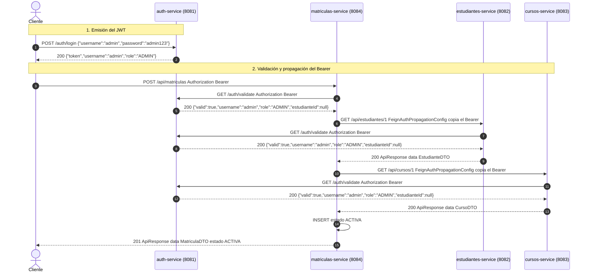
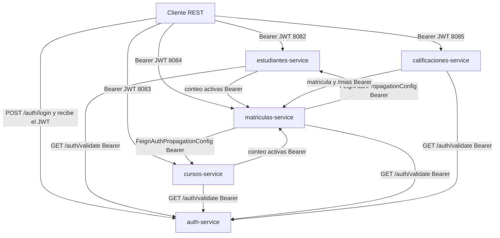

# Proyecto S3 - Sistema Distribuido de Gestión Académica

Cinco microservicios Spring Boot 3.2.5 (Java 21) separan identidad, estudiantes, cursos, matrículas y calificaciones. Cada proceso tiene su propia base H2 en memoria y su propio puerto. No hay una base compartida: las referencias entre agregados son identificadores `Long` y las lecturas cruzadas se hacen con OpenFeign.

La imagen de ejecución es `eclipse-temurin:21-jre`. El Dockerfile copia un JAR ya empaquetado. Docker Compose publica los puertos en el host y une los contenedores en la red `proyecto-s3_default`. Las URLs internas usan el nombre DNS del servicio (`http://auth-service:8081` y equivalentes). `depends_on` ordena el arranque y no espera a que el puerto acepte tráfico.

## Matriz de servicios y puertos

| Servicio | Puerto host:contenedor | Base H2 | Responsabilidad |
|---|---|---|---|
| auth-service | 8081:8081 | authdb | Login BCrypt y JWT HS256 |
| estudiantes-service | 8082:8082 | estudiantesdb | CRUD de estudiantes y correo único |
| cursos-service | 8083:8083 | cursosdb | CRUD de cursos y cupo máximo |
| matriculas-service | 8084:8084 | matriculasdb | Alta, anulación y conteo de matrículas activas |
| calificaciones-service | 8085:8085 | calificacionesdb | Notas por corte y promedio ponderado |

## Requisitos de entorno

- Docker Desktop o Docker Engine con Compose
- Java 21 y Maven 3.9+, solo si las pruebas se ejecutan en el host

El empaquetado de los JAR se hace en el contenedor `maven:3.9.9-eclipse-temurin-21`. Ese contenedor trae JDK 21. El host no necesita `mvn` en el `PATH` para levantar el stack.

## Ejecución

Los comandos se ejecutan en el directorio que contiene `docker-compose.yml`.

### 1. Compilar los JAR en un contenedor efímero

PowerShell:

```powershell
docker run --rm -v "${PWD}:/app" -w /app maven:3.9.9-eclipse-temurin-21 bash -c "cd auth-service && mvn clean package -DskipTests && cd ../estudiantes-service && mvn clean package -DskipTests && cd ../cursos-service && mvn clean package -DskipTests && cd ../matriculas-service && mvn clean package -DskipTests && cd ../calificaciones-service && mvn clean package -DskipTests"
```

Bash:

```bash
docker run --rm -v "$PWD:/app" -w /app maven:3.9.9-eclipse-temurin-21 bash -c "cd auth-service && mvn clean package -DskipTests && cd ../estudiantes-service && mvn clean package -DskipTests && cd ../cursos-service && mvn clean package -DskipTests && cd ../matriculas-service && mvn clean package -DskipTests && cd ../calificaciones-service && mvn clean package -DskipTests"
```

Cada módulo deja su artefacto en `target/<servicio>-0.0.1-SNAPSHOT.jar`. El Dockerfile de cada servicio copia `target/*.jar`.

### 2. Levantar el stack

```bash
docker compose up --build -d
```

`docker compose ps` debe mostrar los cinco contenedores en ejecución. La primera petición que cruza servicios puede coincidir con el arranque de Hibernate. Si responde 502, repetir unos segundos después.

Las pruebas, con Maven en el host y desde el directorio de cada servicio:

```bash
mvn test
```

Son 27 casos. No levantan el resto de procesos: las llamadas Feign de las pruebas están sustituidas por mocks.

## Usuarios de prueba

`DataSeeder` de auth-service inserta estas filas cuando `usuarios` está vacía. La contraseña se guarda con BCrypt. El login es `POST /auth/login` con `username` y `password`.

| Usuario | Contraseña | Rol | estudianteId en el JWT |
|---|---|---|---|
| admin | admin123 | ADMIN | ausente |
| docente | docente123 | DOCENTE | ausente |
| estudiante | estudiante123 | ESTUDIANTE | 1 |

El estudiante de semilla con id 1 pertenece a estudiantes-service (`estudiante0@demoacademico.edu` es el primero de los 50). Cursos siembra `IS3-001`, `BD2-001` y `RED-001`.

## Swagger UI y consola H2

La consola usa el usuario `sa` y la contraseña vacía. La URL JDBC es la de cada `application.yaml`.

| Servicio | Swagger UI | Consola H2 | JDBC |
|---|---|---|---|
| auth-service | http://localhost:8081/swagger-ui.html | http://localhost:8081/h2-console | `jdbc:h2:mem:authdb` |
| estudiantes-service | http://localhost:8082/swagger-ui.html | http://localhost:8082/h2-console | `jdbc:h2:mem:estudiantesdb` |
| cursos-service | http://localhost:8083/swagger-ui.html | http://localhost:8083/h2-console | `jdbc:h2:mem:cursosdb` |
| matriculas-service | http://localhost:8084/swagger-ui.html | http://localhost:8084/h2-console | `jdbc:h2:mem:matriculasdb` |
| calificaciones-service | http://localhost:8085/swagger-ui.html | http://localhost:8085/h2-console | `jdbc:h2:mem:calificacionesdb` |

En Swagger de un servicio de negocio, `POST /auth/login` no existe: el token se obtiene en el puerto 8081 y se envía como `Authorization: Bearer <token>`.

## Arquitectura y recorrido del JWT

`auth-service` firma el token con HS256 (`JwtUtils.signWith`). Los demás servicios no tienen el secreto. Cada uno llama `GET /auth/validate` con el mismo header. `FeignAuthPropagationConfig` copia `Authorization` al template de Feign cuando la interfaz no lo declara.



`LoginResponse` expone `token`, `username` y `role`. `TokenValidationResponse` expone `valid`, `username`, `role` y `estudianteId`. En `admin` y `docente` ese último claim no se escribe, y validate lo devuelve nulo. El cuerpo de estudiantes y de cursos que recibe matrículas es `RemoteApiResponse`: `success`, `message` y `data`.

Topología de la red. Las flechas hacia auth-service son `GET /auth/validate` con el Bearer de la petición. Las flechas Feign entre negocio reenvían ese mismo header.


