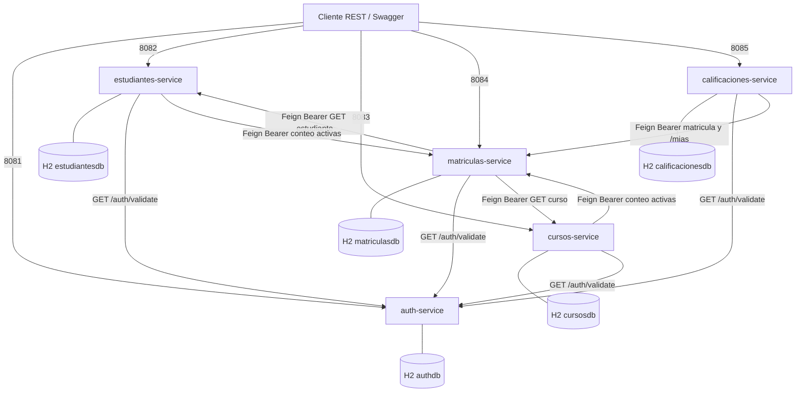
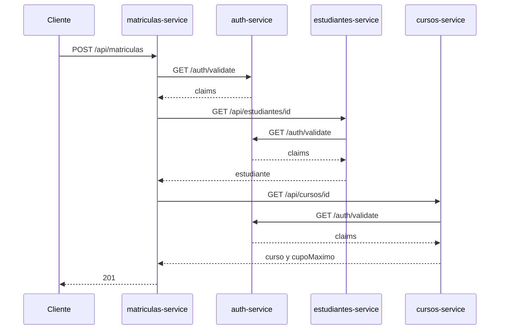

# Especificación técnica. Proyecto S3

Contrato de ejecución verificado: Java 21, Spring Boot 3.2.5, cinco artefactos Maven independientes, imagen `eclipse-temurin:21-jre`, red Compose `proyecto-s3_default`.

## 1. Mapa de red

Cada servicio escucha en `0.0.0.0` del contenedor. El host publica el mismo puerto. La base H2 es `jdbc:h2:mem` dentro del proceso. No hay contenedor de base de datos.

| Servicio | Puerto | Base | Variables inyectadas por Compose |
|---|---:|---|---|
| auth-service | 8081 | `authdb` | Ninguna |
| estudiantes-service | 8082 | `estudiantesdb` | `AUTH_SERVICE_URL`, `MATRICULAS_SERVICE_URL` |
| cursos-service | 8083 | `cursosdb` | `AUTH_SERVICE_URL`, `MATRICULAS_SERVICE_URL` |
| matriculas-service | 8084 | `matriculasdb` | `AUTH_SERVICE_URL`, `ESTUDIANTES_SERVICE_URL`, `CURSOS_SERVICE_URL` |
| calificaciones-service | 8085 | `calificacionesdb` | `AUTH_SERVICE_URL`, `MATRICULAS_SERVICE_URL` |

Valores dentro de la red:

| Variable | Valor |
|---|---|
| `AUTH_SERVICE_URL` | `http://auth-service:8081` |
| `ESTUDIANTES_SERVICE_URL` | `http://estudiantes-service:8082` |
| `CURSOS_SERVICE_URL` | `http://cursos-service:8083` |
| `MATRICULAS_SERVICE_URL` | `http://matriculas-service:8084` |

Sin esas variables, cada `application.yaml` usa `http://localhost:<puerto>`. Ese default vale para `mvn spring-boot:run` en el host. Dentro de un contenedor, `localhost` es el propio contenedor.

`depends_on` ordena el arranque y no espera a que el puerto acepte tráfico. Estudiantes y cursos no declaran a matrículas en `depends_on`: el ciclo de llamadas existe, el ciclo de arranque no.

Aristas de negocio que el grafo de cliente no sustituye:

| Origen | Destino | Uso |
|---|---|---|
| estudiantes, cursos, matriculas, calificaciones | auth-service | Validación del Bearer en cada petición protegida |
| matriculas-service | estudiantes-service, cursos-service | Existencia y `cupoMaximo` en el alta |
| estudiantes-service, cursos-service | matriculas-service | Conteo de matrículas activas antes de borrar; cursos también al reducir el cupo |
| calificaciones-service | matriculas-service | Matrícula activa en el alta y en la corrección; `/mias` para las notas del estudiante |

## 2. Imagen y arranque

Los cinco `Dockerfile` coinciden salvo `EXPOSE`. Copian `target/*.jar` a `/app/app.jar` y ejecutan `java -jar`. Maven no corre en esa imagen. El JAR se produce antes, con JDK 21.

JWT: HS256, expiración 3 600 000 ms, secreto en `application.yaml` de auth-service. Compose no lo sobrescribe.

Semilla con base vacía: `admin`, `docente`, `estudiante` (este último con `estudianteId` 1); 50 estudiantes; cursos `IS3-001` (cupo 30), `BD2-001` (cupo 25), `RED-001` (cupo 2).

## 3. Alta de matrícula

Seis HTTP síncronos. El duplicado y el cupo se resuelven después, en la base local de matrículas.

La página `docs/arquitectura-red.html` dibuja el mismo mapa para abrirlo en el navegador.
